# Red de Nodos de Arquitectura (Knowledge Graph)
**Proyecto:** Portafolio Web - Angel Broce
**Última actualización:** 2026-10-27
**Stack Tecnológico:** HTML5 Semántico, CSS3 Vanilla (Tokens B&W, Glassmorphism, Bento Grid, Microinteracciones), JavaScript Vanilla ES6+ (GitHub REST API, Renderizado Reactivo)

---

## 1. Diagrama Arquitectónico Mermaid

```mermaid
graph TD
    subgraph UI_Presentation ["Capa de Presentación (Frontend Shell)"]
        NODE_HERO["Nodo Hero & Navbar<br/>(Identidad, Quick Links, CV CTA)"]
        NODE_BENTO["Nodo Bento Grid & Tabs<br/>(Proyectos, Habilidades, Sobre Mí, Experiencia)"]
        NODE_FOOTER["Nodo Footer & Métricas<br/>(Status en Vivo, Copyright Dinámico)"]
    end

    subgraph Design_System ["Sistema de Diseño Monocromático (B&W / Noir)"]
        NODE_TOKENS["Tokens de Color & Variables<br/>(Pure Black, Obsidian Slate, Silver, Pure White)"]
        NODE_GLASS["Glassmorphism & Bordes Refractivos<br/>(Backdrop-filter, 1px Border sutil)"]
        NODE_MOTION["Física & Micro-interacciones Emil Kowalski<br/>(Scale 0.97 active, Pulse rings, Ease-out)"]
    end

    subgraph Data_Logic ["Lógica de Negocio y Datos"]
        NODE_API_GITHUB["Servicio GitHub REST API<br/>(Fetch repos AngelBroce, ordenamiento, filtrado)"]
        NODE_INTERACTION["Controlador de Interacciones DOM<br/>(Tabs reactivos, filtrado de tags, smooth scroll)"]
    end

    subgraph Static_Assets ["Activos Estáticos"]
        NODE_ASSET_PROFILE["profile.jpg<br/>(Fotografía de perfil)"]
        NODE_ASSET_CV["Angel_Broce_CV.pdf<br/>(Currículum Vitae descargable)"]
        NODE_ASSET_FAV["favicon.gif<br/>(Ícono de navegación)"]
    end

    subgraph Deployment ["Control de Versiones & Despliegue"]
        NODE_VCS["Git / GitHub Repository<br/>(origin: AngelBroce/portafolio)"]
    end

    %% Relaciones
    NODE_HERO --> NODE_ASSET_PROFILE
    NODE_HERO --> NODE_ASSET_CV
    NODE_BENTO --> NODE_API_GITHUB
    NODE_BENTO --> NODE_INTERACTION
    NODE_HERO --> NODE_TOKENS
    NODE_BENTO --> NODE_GLASS
    NODE_BENTO --> NODE_MOTION
    NODE_API_GITHUB --> NODE_BENTO
    UI_Presentation --> NODE_VCS
```

---

## 2. Índice de Módulos y Responsabilidades

### [NODE-01] Presentación & Shell UI (`index.html`)
- **Responsabilidad:** Estructura semántica HTML5, metadatos SEO / OpenGraph, contenedor principal Bento Grid y áreas de anclaje.
- **Entradas:** Datos inyectados por JavaScript, tokens del sistema de diseño.
- **Salidas:** DOM interactivo accesible (ARIA, contraste WCAG AA/AAA).

### [NODE-02] Sistema de Diseño Monocromático & Motion (`styles.css`)
- **Responsabilidad:** Paleta blanco y negro de alto contraste (obsidiana profunda `#050505` a `#0e0e11`, acentos blanco puro `#ffffff` y grises de titanio `#888899`), superficies de cristal esmerilado con refracción, layouts Bento Grid adaptativos y curvas de animación elásticas bajo el estándar de Emil Kowalski.
- **Entradas:** Variables CSS (`:root`), estados (`:hover`, `:active`, `:focus-visible`).
- **Salidas:** Experiencia visual de alta fidelidad ultra-moderna.

### [NODE-03] Lógica de Datos & API de GitHub (`script.js`)
- **Responsabilidad:** Cliente asíncrono para la API de GitHub (`users/AngelBroce/repos`), filtrado inteligente (excluyendo auto-referencias y repos vacíos), formateo reactivo de tarjetas (lenguajes, estrellas, forks, badges y links a demos/repositorios). Manejo de estados de carga (skeleton loaders / spinners monocromáticos) y errores.
- **Entradas:** Respuesta JSON de la API pública de GitHub.
- **Salidas:** Componentes de tarjeta generados e inyectados en `#projects-container`.

### [NODE-04] Activos de Medios & Identidad (`/`)
- **Responsabilidad:** Archivos multimedia de soporte como `profile.jpg`, `favicon.gif` y el documento `Angel_Broce_CV.pdf`.
- **Entradas:** Archivos binarios locales.
- **Salidas:** Enlaces de descarga y renderizado de imágenes de alta resolución.

### [NODE-05] Versionamiento & Despliegue (`.git`)
- **Responsabilidad:** Gestión de ramas (`master`), commits semánticos y sincronización remota con GitHub (`https://github.com/AngelBroce/portafolio.git`).

---

## 3. Mapeo Quirúrgico a Archivos Directos

| ID de Nodo | Archivo Directo | Formato / Tipo | Estado Actual |
| :--- | :--- | :--- | :--- |
| **NODE-01** | `index.html` | HTML5 / Bootstrap 5 / FontAwesome | Funcional, requiere modernización a Bento Grid B&W |
| **NODE-02** | `styles.css` | CSS3 Vanilla | Oscuro con acentos de color, pendiente refactor a Monocromático Puro & Microinteracciones |
| **NODE-03** | `script.js` | JavaScript ES6+ | Fetch funcional de GitHub, requiere skeleton loading, filtros por lenguaje y física táctil |
| **NODE-04** | `profile.jpg`, `Angel_Broce_CV.pdf`, `favicon.gif` | Binarios / Assets | Disponibles e integrados |
| **NODE-05** | `.git/config` | Git VCS | Vinculado a `AngelBroce/portafolio` |
